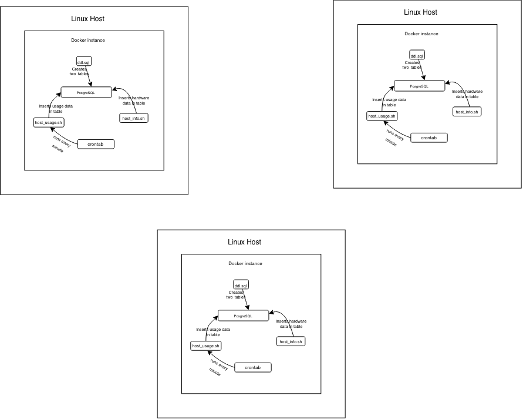

# Linux Monitoring Agent


## Introduction
The LCA team manages a Linux cluster consisting of ten nodes (servers). They require a solution to record the hardware specifications of each node and monitor its resource usage. This project serves as a Minimum Viable Product (MVP) that addresses this requirement by initially monitoring one Linux server. The monitoring agent uses Bash scripts to collect hardware specifications, such as CPU information and total memory, as well as resource usage data, including CPU utilization, memory usage, and available disk space. Hardware information is collected during initial setup, while resource usage is collected every minute because resource utilization changes continuously. The collected information is stored in a centralized PostgreSQL database for future analysis. The technologies used in this project include Bash, PostgreSQL, Docker, Git, and Crontab.


## Quick Start
1. Create/Start a psql instance using psql_docker.sh

```bash
~/dev/jarvis_data_eng_NoorHassan/linux_sql/scripts/psql_docker.sh create rockydb password
```

```bash
~/dev/jarvis_data_eng_NoorHassan/linux_sql/scripts/psql_docker.sh start rockydb password
```

2. Create tables using ddl.sql
```bash
psql -h localhost -U postgres -d host_agent -f ~/dev/jarvis_data_eng_NoorHassan/linux_sql/sql/ddl.sql
```
3. Insert hardware data into the DB using host_info.sh
```bash
~/dev/jarvis_data_eng_NoorHassan/linux_sql/scripts/host_info.sh localhost 5432 host_agent postgres password
```
4. Insert hardware usage data into the DB using host_usage.sh
```bash
~/dev/jarvis_data_eng_NoorHassan/linux_sql/scripts/host_usage.sh localhost 5432 host_agent postgres password
```
5. Crontab setup
```bash
crontab -e
```
add the following entry
```bash
* * * * * bash /home/rocky/dev/jarvis_data_eng_NoorHassan/linux_sql/scripts/host_usage.sh localhost 5432 host_agent postgres password > /tmp/host_usage.log
```

List crontab jobs to verify the job was added successfully
```bash
crontab -l
```

## Implementation

### Architecture


### Scripts
1. psql_docker.sh
creates a docker container that contains PostgreSQL
```bash
~/dev/jarvis_data_eng_NoorHassan/linux_sql/scripts/psql_docker.sh create rockydb password

```
2. Create host_info and host_usage tables using ddl.sql
The tables persist data collected by the host_info and host_usage scripts
```bash
psql -h localhost -U postgres -d host_agent -f ~/dev/jarvis_data_eng_NoorHassan/linux_sql/sql/ddl.sql
```

3. host_info.sh
Will collect hardware specifications of the current node and insert it into the table host_info
```bash
~/dev/jarvis_data_eng_NoorHassan/linux_sql/scripts/host_info.sh localhost 5432 host_agent postgres password
```
4. host_usage.sh
collects the current usage information of the current node and insert it into the table host_usage
```bash
~/dev/jarvis_data_eng_NoorHassan/linux_sql/scripts/host_usage.sh localhost 5432 host_agent postgres password
```

### Database Modeling
Describe the schema of each table using markdown table syntax (do not put any sql code)
1. host_info
   
Collects hardware specifications and persists it in host_info table

| Column            | Data Type |
|-------------------|-----------|
| id                | SERIAL    |
| hostname          | VARCHAR   |
| cpu_number        | INT2      |
| cpu_architecture  | VARCHAR   |
| cpu_model         | VARCHAR   |
| cpu_mhz           | FLOAT8    |
| l2_cache          | INT4      |
| timestamp         | TIMESTAMP |
| total_mem         | INT4      |

2. host_usage
   
Collects hardware usage and persists it in host_usage table

| Column         | Data Type |
|----------------|-----------|
| timestamp      | TIMESTAMP |
| host_id        | SERIAL    |
| memory_free    | INT4      |
| cpu_idle       | INT2      |
| cpu_kernel     | INT2      |
| disk_io        | INT4      |
| disk_available | INT4      |


## Test

Each script was tested individually and manually

1. psql_docker
   - Executed the psql_docker script with the create argument to create the docker container
   - Used the start argument to confirm the existing container has been created
   - Used docker ps to check the container status
   - Result: The PostgreSQL container was successfully created and started

2. ddl.sql
    - Executed the ddl.sql file
    - Connected to PostgreSQL and used \dt to verify tables have been created
    - Result: Both tables have been successfully created

3. host_info.sh 
    - Executed the host_info.sh 
    - Queried the host_info table to verify that the data has been properly inserted

4. host_usage.sh 
    - Executed the host_usage.sh 
    - Queried the host_usage table to verify that the data has been properly inserted

5. crontab 
    - Configure crontab to execute host_usage.sh every minute using the -e flag
    - Use the -l flag to verify that the job has successfully been added
    - Queried host_usage table after a few minutes to confirm the new records are being inserted
    - Result: The new records have been successfully recorded 

## Deployment
The app runs on Linux, with a PostgreSQL  database in docker and uses a crontab to log hardware usage every minute

## Improvements
 
- The host_info script runs once which means if the hardware is changed at any point in the future it must be executed again or the info collected will be out of date

- This only works on the machine it is run on so, the LCA will have to run it individually on each node so an improvement would be to have the scripts collect hardware specifications and usage on all nodes in the cluster

- Include a dashboard that will show the hardware usage of each node visually
